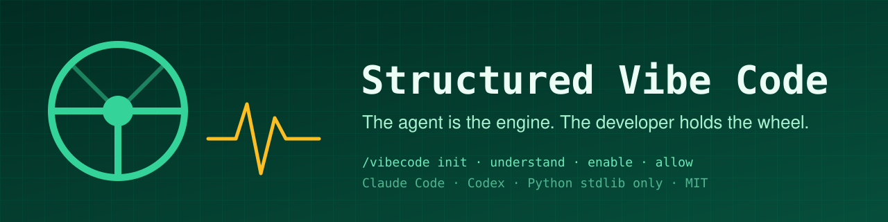

<p align="center">
  
</p>

<p align="center">
  <a href="LICENSE"></a>
  
  
  
  
  <a href="#contributing"></a>
  
</p>

<p align="center">
  <a href="#install">Install</a> ·
  <a href="#commands">Commands</a> ·
  <a href="#active-mode">Active mode</a> ·
  <a href="#allowances">Allowances</a> ·
  <a href="#how-a-decision-looks">How a decision looks</a> ·
  <a href="#terse-voice">Terse voice</a> ·
  <a href="#skills">Skills</a> ·
  <a href="#contributing">Contributing</a>
</p>

**Structured Vibe Code** is a plugin for Claude Code and Codex that keeps the developer in charge while the agent does the work. The agent reads, searches, types, tests and comes back after every step with *what now?* and the options already laid out, with diffs. It never implements a whole module on its own unless you granted a scoped, dated allowance for exactly that.

Engine: the agent. Wheel: you.

## Who this is for

- Developers who use AI agents daily and are tired of reviewing 400-line diffs they did not ask for.
- Teams that want AI speed without losing the thread of *why* the code looks the way it does.
- Anyone maintaining a vibe-coded codebase who needs to understand it before touching it.

**Not recommended** for people without a technical background. The plugin is deliberately technical: it talks in diffs, contracts, failure modes and exit codes, and it expects you to make the calls. If you want an agent that decides for you, this is the wrong tool.

## Why

Vibe coding is fast and it ships code nobody understands. The usual fixes (more prompts, more review, more tests after the fact) do not change the dynamic: the agent still decides, you still catch up. This plugin flips it.

| Default agent behavior | With Structured Vibe Code |
|---|---|
| Picks an approach and implements it | Shows the current code, 2 to 4 options with before/after, a recommendation, then asks |
| Expands scope when it finds related work | Puts it in `.vibecoding/execution-backlog.json` and keeps the slice closed |
| Rewrites a module because you said "improve it" | Refuses open scopes; asks for a bounded outcome or a dated allowance |
| Asks "should I proceed?" with no context | Never asks without showing what it saw first (the `asking` skill) |
| Commits when it thinks it is done | Commits on explicit yes, after showing diff and validation |
| Starts coding in a repo it has never read | `/vibecode understand` reads the history in chunks first |

## Install

### Claude Code

```bash
claude plugin marketplace add hi-mundo/structured-vibe-code-plugin
```

```bash
claude plugin install vibecode@structured-vibe-code-plugin
```

### Codex

[Add marketplace](codex://plugins/marketplace/add?url=https%3A%2F%2Fgithub.com%2Fhi-mundo%2Fstructured-vibe-code-plugin.git), then install `vibecode`. Skills are available as `$vibecode`, `$asking`, `$understand`, `$execution-slices`, `$review-i2b`.

No npm, no pip. Scripts are Python 3.9+ standard library.

## Commands

All optional. They make the plugin easier to work with; the skills work without them.

| Command | What it does |
|---|---|
| `/vibecode` | First run in a repository: creates `.vibecoding/`, `STRUCTURE.md`, `.decisions.jsonl`, adds `.vibecoding/` to `.gitignore` (never overwrites) and turns **active mode** on. Later runs: turns it on again, or shows status (mode, voice, current slice, valid allowances) when already on. |
| `/vibecode off` | Turns active mode off. State lives in `.vibecoding/state.json`, per repository. |
| `/vibecode terse` | Toggles the compressed voice. Comes on with active mode. Questions, warnings and anything persisted stay in full prose either way. |
| `/vibecode understand` | Maps the repository: reads `git log` in chronological chunks, writes `.vibecoding/understanding.md` (how it started, what it became, where it is going), refreshes `STRUCTURE.md`. |
| `/vibecode allow [<scope> --until <YYYY-MM-DD> [--note "..."]]` | Without arguments lists grants, expiry and days left. With a scope (path or glob) grants permission for autonomous implementation inside it until the date. |

## Active mode

When enabled, a hook injects the ruleset at session start and reminds it on every turn, so it does not drift out of the agent's attention after a long session. The four rules:

1. **Show before you ask, ask before you act.** Current code, options with before/after, recommendation, then the question. A bare question is a violation.
2. **Never implement a whole module alone.** Anything bigger than one closed slice needs a valid allowance covering those paths.
3. **Come back after every step.** Diff, validation, what was noticed outside the slice, next options. Commit only on explicit yes.
4. **Never reinvent the wheel.** Anything new to the repository (module, dependency, integration, algorithm) starts with a prior-art search: the repository first, then two to four community projects that solve the same problem. Findings come back as options with source and license. Permissive code may be reused with its notice; copyleft, proprietary or unlicensed code is never copied, only its approach informs the design.

Within those rules the agent is free to be fast: it reads, greps, runs tests, writes the slice you approved, and does not ask you for facts it can find in the repository.

## Allowances

Sometimes you *do* want the agent to build a whole module while you do something else. That is a decision, so it is recorded as one:

```bash
/vibecode allow src/billing/ --until 2026-12-01 --note "rebuild invoice generation, keep the public API"
```

This writes `.vibecoding/allowances/2026-11-01-src-billing-a1b2c3.json`:

```json
{
  "id": "2026-11-01-src-billing-a1b2c3",
  "scope": "src/billing/",
  "granted_at": "2026-11-01T20:14:27+00:00",
  "expires_at": "2026-12-01",
  "granted_by": "raimundo",
  "note": "rebuild invoice generation, keep the public API"
}
```

Before a module-sized slice the agent runs `allowance.py check --path <path>`. Exit `0`: covered, it shows the allowance id and goes. Exit `1` (not covered) or `3` (expired): it stops and offers `/vibecode allow` as one of the options. Allowances are local files, gitignored, per developer.

## How a decision looks

The `asking` skill fixes the shape of every decision request: **current code → options with before/after → recommendation → question**. Rendering picks the best thing the host offers:

- **HTML widget** when the host can render one: option cards side by side, each with its diff and a button that sends the choice back. Flows are drawn, not described.
- **Native question tool** with the recommended option first and the before/after in previews.
- **Plain text** with numbered options and fenced diffs, ending at the question.

Plain-text example:

> **Now** (`server.py:23`):
> ```python
> DB_PATH = Path(os.environ.get("LAR_DB", BASE / "data" / "lar.db"))
> ```
> **Options**
> 1. **Keep env var, add CLI flag** — `--db` overrides `LAR_DB`. Two knobs, both documented.
> 2. **Config file** — `config.toml` next to the binary. Adds a parse step and a file to ship.
> 3. **Defer** — leave as is; revisit when a second setting appears.
>
> → **1.** Smallest change, matches how the server is already started.
>
> Which one?

## Terse voice

**Disclaimer: active mode turns on a compressed speaking style by default.** Explanations come as fragments ("Fixture built before migration. Test fail. Reorder."), code and diffs come in full, and every question to you comes in full sentences with named options. It reads blunt. It is meant to: you pay per token and read in a terminal.

The ruleset is the `ultracave` level of [**caveman** by Julius Brussee](https://github.com/JuliusBrussee/caveman) (MIT), vendored unchanged into [`skills/vibecode/references/terse-upstream.md`](skills/vibecode/references/terse-upstream.md) with the upstream commit in its header. A [weekly GitHub Action](.github/workflows/sync-terse.yml) re-fetches it, runs the tests, and commits the new version when upstream changes, so this plugin follows caveman without forking it. Our own adaptations (what stays in full prose inside the Structured Vibe Code loop) live next to it in [`terse.md`](skills/vibecode/references/terse.md). Credit and license: [THIRD_PARTY_NOTICES.md](THIRD_PARTY_NOTICES.md). If you want the whole caveman experience (levels, commands, stats, other agents), install caveman itself.

Turn it off, keep active mode (same command turns it back on):

```bash
/vibecode terse
```

## What it creates in your repository

```text
STRUCTURE.md                        repository model          committed
.decisions.jsonl                    decision memory           committed
.vibecoding/                        everything below          gitignored
  state.json                        mode: active | off, terse: true | false
  allowances/*.json                 scoped, dated grants
  current-slice.json                the one thing being done now
  execution-backlog.json            noticed, not done
  understanding.md                  output of /vibecode understand
  i2b-validation.json               last review-i2b result
```

## Skills

| Skill | Role | Invoked |
|---|---|---|
| `vibecode` | The loop: preflight, decisions, closed slice, allowance gate, implement, validate, report | by the agent in active mode, or `$vibecode` |
| `asking` | The decision protocol and its renderings | by every other skill when a human call is needed |
| `prior-art` | What already exists before building: repository, then community projects, with license gate | by the loop whenever the task adds something new to the repository, or `$prior-art` |
| `understand` | Repository and history mapping in chunks | `/vibecode understand` |
| `execution-slices` | Scope gates: what counts as a closed slice, what goes to the backlog | inside the loop |
| `review-i2b` | Intent-to-behavior review before commit: reconstruct intended behavior, inspect at least three revisions, collect reproducible evidence | inside the loop, or `$review-i2b` |

## Scripts

Standard library only, one JSON object on stdout, meaningful exit codes. The skills tell the agent what each code means; nonzero is information for you, not an obstacle for the agent to route around.

| Script | Purpose | Exit codes |
|---|---|---|
| `scripts/vibecode_init.py` | create support files | 0 |
| `scripts/vibecode_state.py get\|set active\|off\|terse on\|off` | mode and voice switches | 0 |
| `scripts/sync_terse.py [--check]` | vendor the upstream ultracave ruleset | 0 · 1 drift (`--check`) · 2 fetch failed |
| `scripts/allowance.py grant\|check\|list\|revoke` | scoped permissions | 0 covered · 1 not · 2 usage · 3 expired |
| `scripts/history_chunks.py` | chronological history chunks | 0 · 1 too short · 2 git failed |
| `scripts/protector_preflight.py` | worktree, model, decision-log gates | 0 · 1 gates failed · 2 not a repo |
| `scripts/decision_log.py` | JSONL decision memory with bounded retention; `--prior-art-json` records sources and licenses | 0 · 1 corrupted · 11 bad prior-art shape |
| `scripts/review_preflight.py` | deterministic inventory for review-i2b | 0 · 1 blocked |
| `scripts/mimic_python.py` | isolated probe of a Python callable | see `--help` |
| `scripts/validate_report.py` | schema check for review-i2b reports | 0 · 1 invalid |

## Development

```bash
python3 -m unittest discover tests
```

```bash
python3 -m compileall -q scripts hooks
```

Hooks are tested by piping the JSON Claude Code sends:

```bash
echo '{"cwd":"'$PWD'","prompt":"<command-name>/vibecode</command-name><command-args>enable</command-args>"}' | python3 hooks/prompt_submit.py
```

## Contributing

Issues and PRs welcome. The bar: a change must keep the developer deciding. Features that make the agent decide more on its own belong in a different plugin.

- Skills are prose contracts; keep them direct and technical, no cheerleading.
- Scripts stay standard library, JSON out, documented exit codes.
- Hooks must never fail a session: catch everything, exit 0, timeout 5.
- Run the tests and `git diff --check` before opening a PR.

## Keywords

vibecoding · caveman · terse · token-efficient · vibe coding · human-in-the-loop · pair programming · AI coding agent · Claude Code plugin · Codex plugin · code review · intent-to-behavior · execution slices · decision log · guardrails · developer tools · AI-assisted development · agent safety · scoped permissions

## License

MIT. See [LICENSE](LICENSE).
